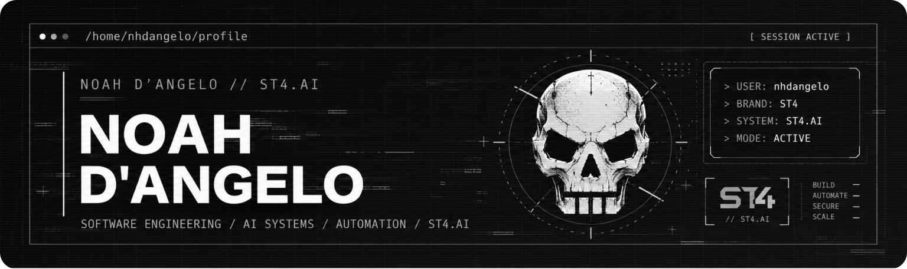
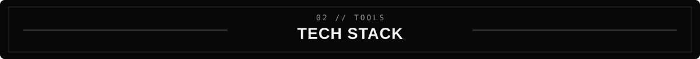
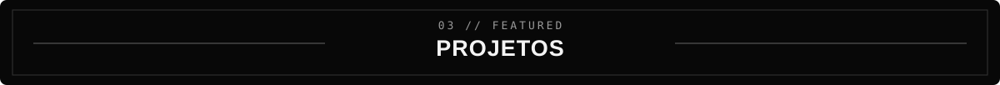
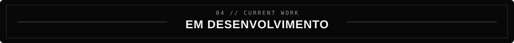
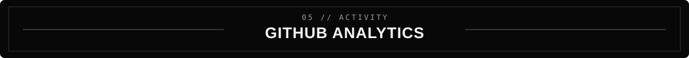
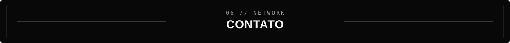

<div align="center">




</div>


Sou Noah D’Angelo, desenvolvedor Full Stack e fundador da ST4. Minha trajetória é movida pela programação, pelo desenvolvimento de sistemas e pelo interesse em tecnologias de automação responsiva.
Desde 2025, venho aprofundando meu trabalho em soluções que integram interfaces, sistemas, APIs e infraestrutura. Meu foco é criar experiências úteis, confiáveis e capazes de evoluir junto com as necessidades de cada projeto.

Desenvolvo sistemas, interfaces e automações com foco em aplicações reais. Entre os trabalhos que desenvolvo estão a **ST4**, uma ferramenta com experiências baseadas em **IA**, como o **ST4.AI**. 
CRM Merion Connect, sistema da empresa <a class="company-link" href="https://merionglobal.com/" target="_blank" rel="noopener noreferrer">Merion Global Logistics</a>. 

Mais do que criar funcionalidades, busco enfrentar desafios técnicos, elevar o padrão das soluções e contribuir para resultados concretos.

```js
const nhdangelo = {
  location: "São Paulo, Brasil",
  projects: ["ST4", "ST4.AI"],
  focus: ["Software Engineering", "AI Systems", "Automation"],
  approach: "Build. Test. Ship."
};
```



<div align="center">

**Languages & Web**


**Tools & Infrastructure**


</div>




| Projeto | Descrição | Áreas |
| :--- | :--- | :--- |
| **[ST4](https://st4global.com/)** | Ecossistema de tecnologia e produtos digitais | Software · Web · Automation |
| **[ST4.AI](https://st4global.com/c/)** | Plataforma de inteligência artificial em desenvolvimento | AI Systems · Agents · Interfaces |
| **CRM | MERION CONNECT** | Sistema interno em desenvolvimento para a Merion Global Logistics. | CRM · Software Engineering · Logistics |
| **[PORTFÓLIO](https://st4global.com/nhdangelo@portfolio/)** | Portfólio pessoal | Frontend · UI · Web |

<sub>O atalho pra acessar CRM | MERION CONNECT está indisponível por razões legais e autorais.</sub>



```text
~/st4 $ status

[+] ST4         | Digital products
[+] ST4.AI      | AI systems & agents
[+] Automation  | Integrations & workflows
[+] Engineering | Development & deployment
```

<div align="center">

<br/>



<br/>

</div>




<div align="center">

<a href="https://github.com/nhdangelo?tab=overview&from=2026-01-01&to=2026-12-31"></a>

<sub>O histórico de contribuições e repositórios públicos pode ser consultado diretamente no <a href="https://github.com/nhdangelo">GitHub</a>.</sub>

</div>



<div align="center">

<a href="https://st4global.com/nhdangelo@portfolio/"></a>
<a href="https://st4global.com/"></a>
<a href="https://st4global.com/c/"></a>

<br/><br/>

<sub>Desenvolvido pela <a href="https://st4global.com/">ST4</a> com ajuda do <a href="https://ai.st4global.com">ST4.AI</a></sub>

</div>
